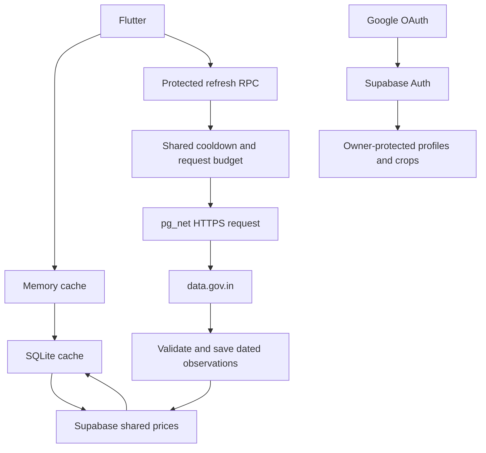

# Raitha Mitra

Flutter Android app for Karnataka mandi prices and crop records. Supabase provides authentication, PostgreSQL storage and protected backend RPCs. ML training is deferred.

## Run

The Supabase project URL and publishable client key are included as app defaults, so a normal run/build is ready to use. To point a build at another Supabase project, copy `config.example.json` to git-ignored `config.local.json`, fill its URL and publishable key, and pass `--dart-define-from-file=config.local.json`.

Only a publishable client key belongs in the mobile app. Never put a database password or service-role/secret key in Flutter; protect data with the existing Row Level Security policies.

```sh
flutter pub get
flutter run
# Or build an APK for device evaluation:
flutter build apk --debug
adb install -r build/app/outputs/flutter-apk/app-debug.apk
```

Package ID: `in.raithamitra.raitha_mitra`. Release signing is not configured.

## Google OAuth

Enable Google under Supabase Authentication → Sign In / Providers using a Google Web OAuth client ID and secret.

- Google authorised redirect URI: `https://zzgpdjqmzepjevnnwvmr.supabase.co/auth/v1/callback`
- Supabase allowed redirect URL: `in.raithamitra.app://login-callback`

The manifest registers the callback. Google consent is completed by the user on the phone. Users can also register and sign in with an email address and password; if email confirmation is enabled in Supabase, the confirmation link returns to the app. Account changes require a successful server save; saved account records remain readable offline.

## Implemented

Welcome, Google and email/password login, profile and district/mandi selection; Home with dated prices and crop cards; district directory and market details; variety/grade comparison; real price history; crop creation/edit/removal; support portal links; price watchlist; Groq-backed Ask Mitra chat (requires function deployment and sign-in); settings; memory and SQLite caching. The directory is bundled for offline use. The interface uses solid colours and labelled icons. Core navigation/onboarding labels have Kannada translations; some details and errors remain English.

## Database and ingestion

SQL is in `supabase/migrations/`. Source tables have an `rm_` prefix. Row-level security protects private profiles, crops and watchlists; app users cannot write market data. Source credentials stay in Supabase Vault, named `rm_data_gov_api_key`.

The imported directory contains 31 district labels and 189 entries from the supplied workbook. Coordinates and official yard status are not verified. Source observations in `data/source/` contain no credentials. Records retain market, commodity, variety, grade and report date. Dates are parsed as day/month/year.

Live API resource: `9ef84268-d588-465a-a308-a864a43d0070` (Current Daily Price of Various Commodities from Various Markets). The earlier variety-wise resource is retained only as the format accepted by the importer. The public test key is configured in Supabase Vault and is limited to 10 records per request; use an account key for broader results. Initial prices are a partial source sample, not statewide coverage.

For further imports, save a JSON object containing `records` in `data/source/`, set `PGHOST`, `PGUSER`, `PGPASSWORD`, `PGDATABASE` in your shell, then run:

```sh
python -m pip install -r scripts/requirements.txt
python scripts/import_data.py
```

`--migrate` is for a fresh database only. The connected project's initial migrations have already been applied. The importer is repeatable and matches only unambiguous names after normalizing the APMC suffix.

## Request flow



Backend functions are deployed in Supabase PostgreSQL; this build does not depend on a local web server. Refreshes for a mandi share state. The server checks for a saved Karnataka-local today row before contacting data.gov.in. If one exists, app opens read Supabase and make no source call for that mandi that day. If today's report has not arrived, the server tries at most once per mandi per Karnataka calendar day, then checks again the next day. The shared upstream budget remains 60 requests per local day.

Hosted Supabase requests to data.gov.in timed out during verification. Failed refreshes retain saved observations and their actual report dates. Reliable source connectivity and a working account API key remain necessary for automatic live updates and complete coverage.

## Deferred

- Trained ML forecasts are not included. Crop and price details show an LLM-generated seven-day price range and conditional sell guidance when at least three dated reports are available; the reported current/low/high values remain source data.
- When a market/crop has no source report, `lib/data/demo_price_provider.dart` supplies local sample modal/low/high prices and a dated sample history. The UI identifies these as simulated examples, excludes them from LLM and backend forecasts, and never writes them to Supabase. Replace this provider when a verified statewide source is available. Price snapshots and LLM outlooks persist in the local SQLite cache; users can explicitly refresh source market reports.
- Verified mandi coordinates and automatic nearest-market selection.
- Complete historical backfill, source pagination and scheduled ingestion.
- Verified crop maturity tables: harvest dates are currently farmer-entered estimates.
- Background push notifications and verified insurance deadlines. Watchlists currently check recent saved reports while the app is open.
- Voice input. Ask Mitra now has a Groq integration; deployment status is described below.
- Full Kannada translation of detail screens.

## Checks

```sh
flutter analyze
flutter test
python scripts/check_security.py
```

The security check uses the PostgreSQL environment variables, verifies anonymous isolation, owner-only profile access and denied directory writes, then rolls back all fixtures.

## Ask Mitra / Groq

`supabase/functions/ask-mitra/index.ts` verifies the user's session, reads their crop records using RLS, loads selected-market reports, and calls Groq. It also accepts a `price_outlook` mode that reads up to 14 dated observations for the selected mandi, variety, and grade, then returns a checked seven-day range and conditional selling guidance. Forecast requests require sign-in and count toward the same 40-call daily user quota. The API key is a backend secret, never a Flutter define. The gateway JWT check is disabled because the function explicitly verifies the token through `auth.getUser()`; unauthenticated requests are rejected.

Deployment after CLI login:

```sh
npx supabase login
npx supabase link --project-ref zzgpdjqmzepjevnnwvmr
npx supabase secrets set --env-file supabase/functions/.env --project-ref zzgpdjqmzepjevnnwvmr
npx supabase functions deploy ask-mitra --project-ref zzgpdjqmzepjevnnwvmr
```

The ignored local secrets file has restricted permissions. `GROQ_API_KEY` is required; `GROQ_MODEL` currently uses `openai/gpt-oss-20b`, verified against this account's model list. The chat quota migration was applied directly to the database. The function is deployed to the linked project. A live authenticated smoke test returned the correct Bottle gourd price and report date; anonymous access returned HTTP 401. The temporary test account was deleted. Local Groq connectivity returned a Kannada response successfully. The chat UI discloses that questions, recent conversation, and relevant crop/market data are sent to Groq. Chats are held in memory and no model response can modify records.

Crop autocomplete matches English and Kannada display labels while retaining canonical commodity names for database price matching. Translations cover the bundled common crop list; unknown source names retain their original label. Main text and navigation labels now use neutral black/grey, with green retained as an accent.

## Visual refresh and Google redirect check — 22 October 2026

Shared screens use a pale sage background, near-black text, white rounded cards, forest-green accents and a rounded bottom navigation bar. Ask Mitra is accessible through a floating button across the main app and detail routes; it hides while typing and on the chat screen. Preview users can start sign-in directly from chat.

The Google Web client's redirect URI was corrected by the project owner. A fresh authorization request reached Google's sign-in page without `redirect_uri_mismatch`. The Supabase allowed redirect list was also empty; `in.raithamitra.app://login-callback` has now been added through the CLI. A fresh sign-in is required after this change. Full account consent and return to the Android app still need completion on the user's phone. Eight tests pass, including the floating assistant opening and returning to the main screen.
